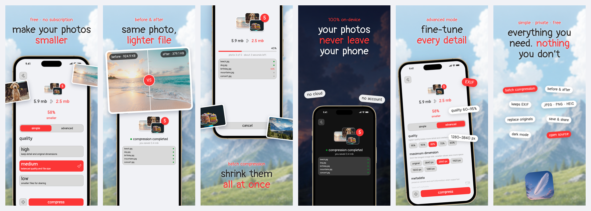
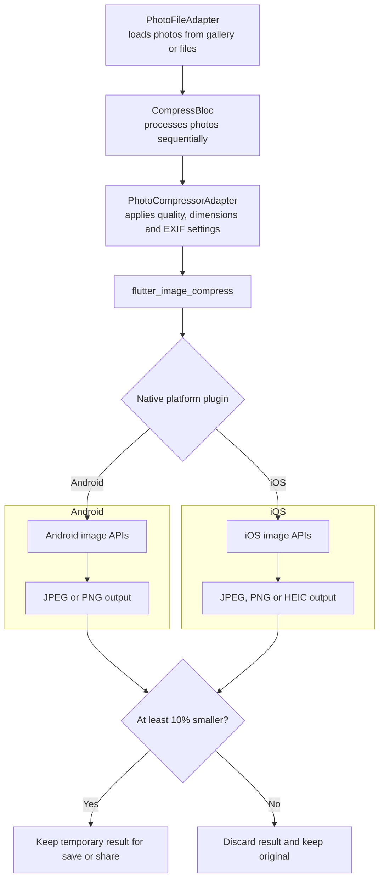

<!-- TODO: Add store links after release. -->
  

minimo (photo) is a free mobile app for shrinking photos directly on your device.
No cloud upload. No subscription. Your photos stay yours.

## Features

- Simple quality presets: high, medium, low
- Advanced controls: quality, maximum dimensions, and EXIF metadata
- Batch compression with progress and cancellation
- Before-and-after comparison
- Save and share compressed photos

## Native compression pipeline

The selected preset sets JPEG quality and a maximum image side. A photo is
skipped when recompression saves less than 10%; this commonly happens when its
dimensions are already below the preset limit. iOS keeps HEIC output for
HEIC/HEIF sources; Android writes them as JPEG.

## How to contribute

 

## Credits

- Photo compression is powered by [flutter_image_compress](https://pub.dev/packages/flutter_image_compress). Respect and thanks to its maintainers and contributors.
- Store screenshot editor: [app-store-screenshots](https://github.com/ParthJadhav/app-store-screenshots) by [Parth Jadhav](https://x.com/parthjadhav8).
- Local metadata workflow: [asc-metadata-sync](https://github.com/rorkai/app-store-connect-cli-skills/tree/main/skills/asc-metadata-sync) and [App Store Connect CLI](https://github.com/rorkai/App-Store-Connect-CLI) by [Rudrank Riyam](https://x.com/rudrank).

## Contacts

   

## License

